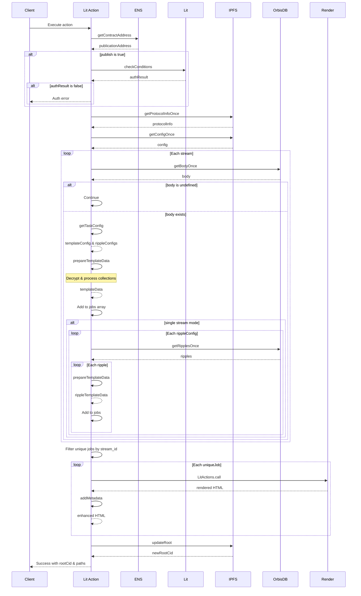

# NeutralPress Protocol Action Flow

This diagram illustrates the sequence of calls in the NeutralPress protocol starting from `main.ts`.

## Flow Summary

1. **Setup Phase**:
   - Resolve publication ENS name to contract address
   - Verify publishing permissions (when publish=true)
   - Fetch protocol info and publication config

2. **Content Processing Phase**:
   - Process each stream: fetch body → determine template → prepare data → add to jobs
   - For single streams: process related "ripples" content for comprehensive updates
   - Includes collection processing from OrbisDB and merging from body.base

3. **Rendering & Publishing Phase**:
   - Deduplicate jobs by stream_id
   - Render HTML via secondary Lit Action
   - Add metadata to enhance SEO and presentation
   - Calculate new IPFS root CID
   - Publish changes (when publish=true)

## Data Flow Details

In `prepareTemplateData`:
1. Decrypt content with appropriate keys
2. Process collections from OrbisDB queries
3. Merge collections from body.base
4. Create paths and format template data

The rendering process supports multiple templates and content types, enabling structured websites with interconnected content.